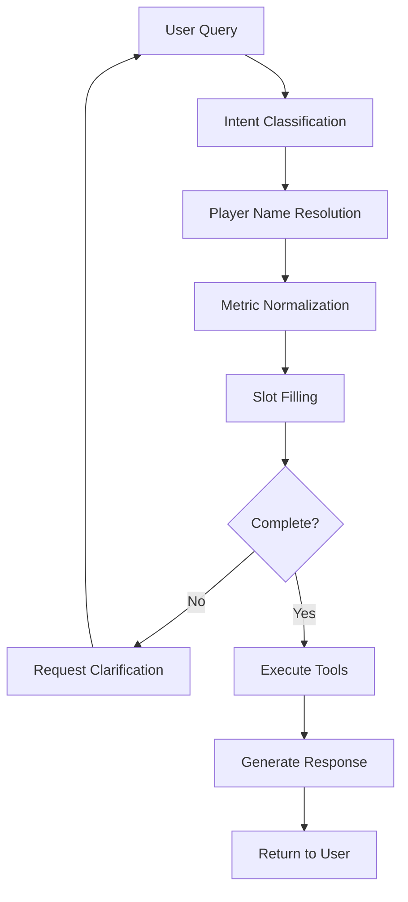
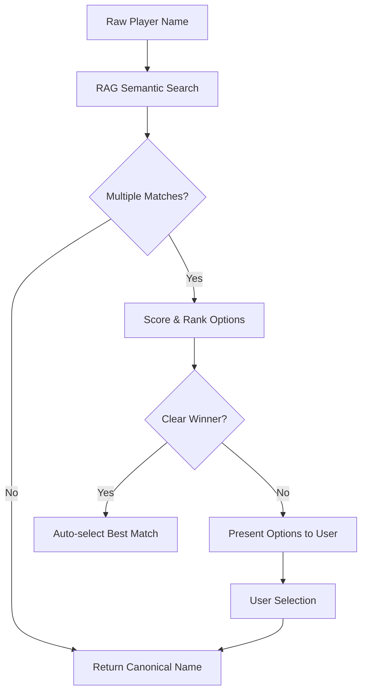
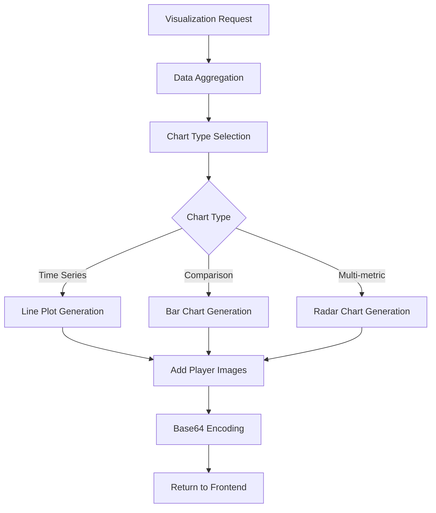

# Football Analytics AI - Complete Codebase Specification

## 🏆 Project Overview

This is a comprehensive football analytics platform that combines AI-powered natural language processing with advanced statistical analysis and visualization. The system allows users to query football data using natural language, compare players, generate insights, and visualize statistics through an intelligent conversational interface.

## 🏗️ System Architecture

```
┌─────────────────┐    ┌──────────────────┐    ┌─────────────────┐    ┌──────────────────┐
│   Next.js Web   │    │   FastAPI API    │    │  LangChain      │    │   MCP Server     │
│   Frontend       │◄──►│   Gateway        │◄──►│  Agent          │◄──►│   (Tools)        │
│   (Netlify)      │    │   (Railway)      │    │  (Core Logic)   │    │   (Local/Cloud)  │
└─────────────────┘    └──────────────────┘    └─────────────────┘    └──────────────────┘
                                                         │
                                                         ▼
                                               ┌─────────────────┐
                                               │   Data Layer    │
                                               │   - CSV Files   │
                                               │   - FAISS Index │
                                               │   - SQLite      │
                                               └─────────────────┘
```

## 📁 Directory Structure

```
football_base/
├── api/                          # FastAPI backend server
│   ├── main.py                   # WebSocket API gateway
│   └── requirements.txt          # API dependencies
├── mcp/                          # Model Context Protocol server
│   ├── mcp_server.py            # MCP HTTP server
│   ├── tools.py                 # Football data tools
│   └── config.py                # Configuration management
├── scripts/                      # Core processing scripts
│   ├── langchain_agent.py       # Main AI agent logic
│   ├── football_api.py          # External API integration
│   └── batch_embed.py           # Vector embedding generation
├── web/                         # Next.js frontend application
│   ├── app/
│   │   ├── page.tsx             # Main chat interface
│   │   ├── layout.tsx           # App layout
│   │   └── globals.css          # Global styles
│   ├── package.json             # Frontend dependencies
│   └── netlify.toml             # Deployment configuration
├── data/                        # Data storage
│   ├── FINAL_with_rag.csv       # Main dataset
│   ├── vectorstore/             # FAISS embeddings
│   └── images/                  # Player/team images
├── .env.example                 # Environment template
├── requirements.txt             # Python dependencies
├── Procfile                     # Railway deployment
└── railway.toml                 # Railway configuration
```

## 🧠 Core Components

### 1. AI Agent (`scripts/langchain_agent.py`)

**Purpose**: Central intelligence engine that processes natural language queries and orchestrates responses.

**Key Features**:
- **Intent Classification**: Automatically detects query types (compare, plot, aggregate, search, ranking)
- **Player Name Resolution**: Advanced fuzzy matching with RAG-powered disambiguation
- **Metric Normalization**: Maps natural language terms to database columns
- **Context Management**: Maintains conversation history and pronoun resolution
- **Slot Filling**: Intelligently extracts structured data from unstructured queries

**Core Functions**:
```python
def handle_input(text: str)                    # Main entry point
def parse_intent_with_llm(query: str)          # LLM-powered intent parsing
def resolve_player_name_with_rag(name: str)    # Smart player name resolution
def interactive_slot_manager(text, intent)     # Intelligent slot filling
def synthesize_tool_output(tool, result, query) # Natural language generation
```

**Intent Types**:
- `compare`: Player vs player comparisons
- `plot`: Time series visualizations
- `aggregate`: Statistical summaries
- `search`: Player information lookup
- `ranking`: Top N player lists
- `natural`: General conversation

### 2. MCP Tools (`mcp/tools.py`)

**Purpose**: Provides structured access to football data through standardized tool interfaces.

**Available Tools**:

#### Core Data Tools
```python
def search_player(query: str, k: int = 5)
# Semantic search using FAISS embeddings
# Returns: List of player matches with confidence scores

def aggregate_player_stat(player_name: str, stat: str, seasons_back: int = 5)
# Aggregates statistics across multiple seasons
# Returns: Per-season breakdown with totals

def plot_player(player_name: str, metrics: List[str])
# Generates time-series plots for player metrics
# Returns: Base64 encoded PNG image

def compare_players(players: List[str], stat: str)
# Multi-player statistical comparison
# Returns: Structured comparison data

def filter_players(team: str = None, position: str = None)
# Filters players by team/position criteria
# Returns: List of matching players

def plot_group(players: List[str], metrics: List[str])
# Creates group comparison visualizations
# Returns: Combined time-series and radar charts
```

#### Advanced Analytics Tools
```python
def rank_players_mcp(stat: str, top_n: int = 10)
# Fast bulk ranking by statistics
# Returns: Top N players with values

def aggregate_group_multi_metrics_mcp(players: List[str], metrics: List[str])
# Bulk aggregation for multiple players/metrics
# Returns: Comprehensive multi-dimensional data

def get_schema_mcp()
# Returns available database columns
# Used for metric validation and mapping
```

### 3. FastAPI Gateway (`api/main.py`)

**Purpose**: WebSocket-based API that bridges the web frontend with the AI agent.

**Key Features**:
- **Real-time Communication**: WebSocket support for streaming responses
- **Image Handling**: Automatic detection and base64 encoding of generated charts
- **Error Management**: Robust error handling and connection management
- **CORS Support**: Cross-origin resource sharing for web deployment

**WebSocket Message Types**:
```typescript
type MessageType = 
  | { type: 'text', content: string }
  | { type: 'image', filename: string, data: string }
  | { type: 'complete', content: string }
  | { type: 'error', content: string }
  | { type: 'ack', content: string }
```

### 4. Web Frontend (`web/app/page.tsx`)

**Purpose**: Modern React-based chat interface with real-time visualization capabilities.

**Key Features**:
- **Real-time Chat**: WebSocket-powered conversation interface
- **Image Viewer**: Dedicated panel for chart visualization with zoom controls
- **Responsive Design**: Football-themed UI with pitch background
- **Connection Management**: Automatic reconnection and status indicators
- **Message Streaming**: Real-time text streaming for better UX

**UI Components**:
- Chat message display with user/assistant differentiation
- Image viewer with zoom, fullscreen, and download capabilities
- Input field with send button and keyboard shortcuts
- Connection status indicator
- Loading states and error handling

## 📊 Data Layer

### Primary Dataset (`data/FINAL_with_rag.csv`)

**Structure**: Comprehensive football statistics with RAG-enhanced summaries

**Key Columns**:
```
Player Information:
- player: Player name (canonical)
- nation: Nationality
- pos: Position
- squad: Team/club
- comp: Competition
- season: Season identifier
- age_stats: Age during season

Performance Metrics:
- goals: Goals scored
- assists: Assists provided
- xg: Expected goals
- npxg: Non-penalty expected goals
- xag: Expected assists
- playing_time_*: Minutes, starts, appearances
- progressive_*: Progressive actions
- goals_per_90: Per-90-minute rates
- assists_per_90: Per-90-minute rates

Financial Data:
- gross_p_w_eur: Weekly wage (EUR)
- gross_p_y_eur: Annual salary (EUR)
- adj_gross_eur: Adjusted gross salary

Enhanced Fields:
- rag_summary: AI-generated player summaries
```

### Vector Store (`data/vectorstore/`)

**Purpose**: FAISS-based semantic search index for intelligent player matching.

**Components**:
- `index.faiss`: Vector embeddings index
- `metadata.pkl`: Associated metadata for search results

**Generation Process**:
```python
# scripts/batch_embed.py
1. Load player data and RAG summaries
2. Generate embeddings using OpenAI text-embedding-3-small
3. Build FAISS index with L2 normalization
4. Store metadata for result mapping
```

### Cache Layer (`data/agent_cache.sqlite`)

**Purpose**: SQLite-based caching for API responses and computed results.

**Schema**:
```sql
CREATE TABLE cache (
    key TEXT PRIMARY KEY,
    value_json TEXT,
    ts INTEGER
);
```

## 🔧 Configuration Management

### Environment Variables

**Core Settings**:
```bash
# AI/ML Configuration
OPENAI_API_KEY=sk-...                    # OpenAI API key
OPENAI_CHAT_MODEL=gpt-4o-mini           # Chat model
OPENAI_EMBED_MODEL=text-embedding-3-small # Embedding model
OPENAI_TEMPERATURE=0.0                   # Response temperature

# Data Paths
DATA_PATH=./data/FINAL_with_rag.csv      # Main dataset
VECTORSTORE_DIR=./data/vectorstore       # FAISS index location
AGENT_CACHE_DB=./data/agent_cache.sqlite # Cache database

# MCP Server
MCP_URL=http://localhost:8080/invoke     # MCP server endpoint
MCP_API_KEY=your_mcp_key                 # MCP authentication
MCP_TIMEOUT=10                           # Request timeout

# Performance Tuning
DEFAULT_SEASONS_BACK=5                   # Default season range
TOP_RAG_MIN_SCORE=0.7                   # RAG confidence threshold
CACHE_TTL_SECS=86400                     # Cache expiration (24h)
CACHE_MAX_ENTRIES=2000                   # Max cache size

# External APIs
FOOTBALL_API_KEY=your_rapidapi_key       # RapidAPI football data
```

### Deployment Configuration

**Railway (Backend)**:
```toml
# railway.toml
[build]
nixpacksPlan = "api"

[deploy]
startCommand = "uvicorn api.main:app --host 0.0.0.0 --port $PORT"
healthcheckPath = "/health"
healthcheckTimeout = 100
restartPolicyType = "always"
```

**Netlify (Frontend)**:
```toml
# web/netlify.toml
[build]
  command = "npm run build"
  publish = ".next"

[[plugins]]
  package = "@netlify/plugin-nextjs"
```

## 🚀 Key Workflows

### 1. Natural Language Query Processing



### 2. Player Name Disambiguation



### 3. Visualization Generation



## 🎨 Visualization Capabilities

### Chart Types

**1. Time Series Plots**
- Player performance over multiple seasons
- Multiple metrics on same chart
- Seasonal trend analysis
- Missing data handling

**2. Comparison Charts**
- Side-by-side player comparisons
- Multi-metric radar charts
- Percentile rankings
- Visual VS layouts with player photos

**3. Ranking Visualizations**
- Top N player lists
- League/competition rankings
- Position-specific comparisons
- Statistical distributions

### Visual Enhancements

**Player Integration**:
- Automatic player photo retrieval (via RapidAPI)
- Team logo integration
- Color-coded team themes
- Professional VS-style layouts

**Chart Styling**:
- Dark theme optimized for web
- Football-themed color schemes
- Responsive design
- High-DPI support (150 DPI)

## 🔍 Advanced Features

### 1. Intelligent Slot Filling

The system can extract structured information from natural language:

```
"Compare Messi's goals with Ronaldo's assists over the last 3 seasons"
↓
{
  intent: "compare",
  players: ["Lionel Messi", "Cristiano Ronaldo"],
  metrics: ["goals", "assists"],
  seasons_back: 3,
  viz: "auto"
}
```

### 2. Context-Aware Conversations

Maintains conversation context for follow-up queries:

```
User: "Compare Haaland and Mbappe"
Agent: [Shows comparison]
User: "Who is better at assists?"
Agent: [Understands "who" refers to Haaland vs Mbappe]
```

### 3. Fuzzy Name Matching

Handles typos and variations in player names:

```
"petri" → "Pedri"
"mbappe" → "Kylian Mbappé" (not "Ethan Mbappé")
"cr7" → "Cristiano Ronaldo"
```

### 4. Metric Aliasing

Maps natural language to database columns:

```
"goals per game" → "goals_per_90"
"expected goals" → "xg"
"weekly wage" → "gross_p_w_eur"
"assists" → "assists"
```

## 🔧 Performance Optimizations

### 1. Caching Strategy

**Multi-level Caching**:
- SQLite cache for API responses (24h TTL)
- In-memory schema caching
- FAISS index preloading
- Result memoization

### 2. Bulk Operations

**Optimized Data Access**:
- `aggregate_group_multi_metrics_mcp`: Single call for multiple players/metrics
- `rank_players_mcp`: Fast bulk ranking operations
- Vectorized pandas operations
- Efficient FAISS searches

### 3. Smart Defaults

**Intelligent Fallbacks**:
- Position-based metric defaults
- Seasonal data prioritization
- Confidence-based auto-selection
- Graceful degradation

## 🚀 Deployment Architecture

### Production Stack

**Frontend (Netlify)**:
- Next.js 14 with App Router
- TypeScript for type safety
- Tailwind CSS for styling
- WebSocket client for real-time communication

**Backend (Railway)**:
- FastAPI with WebSocket support
- Uvicorn ASGI server
- Automatic scaling
- Health check endpoints

**Data Processing**:
- Local MCP server (can be cloud-deployed)
- SQLite for caching
- FAISS for vector search
- OpenAI API integration

### Scalability Considerations

**Horizontal Scaling**:
- Stateless API design
- Shared cache layer
- Load balancer ready
- Container-friendly

**Performance Monitoring**:
- Health check endpoints
- Request/response logging
- Error tracking
- Cache hit rate monitoring

## 🔐 Security & Privacy

### API Security

**Authentication**:
- MCP API key validation
- Environment variable protection
- CORS configuration
- Rate limiting ready

**Data Protection**:
- No PII storage in logs
- Secure environment variable handling
- HTTPS enforcement in production
- Input sanitization

## 📈 Usage Examples

### Basic Queries
```
"Who is Pedri?"
"Compare Haaland and Mbappe"
"Top 10 goal scorers in 2023"
"Show me Benzema's goals over time"
```

### Advanced Queries
```
"Compare the xG per 90 of all Barcelona forwards"
"Plot Salah's assists and goals for the last 4 seasons"
"Who are the highest paid midfielders in the Premier League?"
"Show me a radar chart comparing Messi and Ronaldo on all metrics"
```

### Follow-up Conversations
```
User: "Compare Messi and Ronaldo"
Agent: [Shows comparison]
User: "What about their assists?"
Agent: [Updates to show assists comparison]
User: "Who has better xG?"
Agent: [Compares expected goals]
```

## 🛠️ Development Setup

### Local Development

1. **Environment Setup**:
```bash
cp .env.example .env
# Fill in your API keys
```

2. **Install Dependencies**:
```bash
pip install -r requirements.txt
cd web && npm install
```

3. **Start Services**:
```bash
# Terminal 1: MCP Server
python mcp/mcp_server.py

# Terminal 2: FastAPI Backend
cd api && uvicorn main:app --reload

# Terminal 3: Next.js Frontend
cd web && npm run dev
```

4. **Access Application**:
- Frontend: http://localhost:3000
- Backend API: http://localhost:8000
- MCP Server: http://localhost:8080

### Data Preparation

1. **Generate Embeddings**:
```bash
python scripts/batch_embed.py
```

2. **Verify Data**:
```bash
python -c "
import pandas as pd
df = pd.read_csv('data/FINAL_with_rag.csv')
print(f'Loaded {len(df)} records')
print(f'Unique players: {df.player.nunique()}')
print(f'Seasons: {sorted(df.season.unique())}')
"
```

## 🎯 Future Enhancements

### Planned Features

1. **Enhanced Analytics**:
   - Predictive modeling
   - Performance trend analysis
   - Injury impact assessment
   - Transfer value estimation

2. **Extended Data Sources**:
   - Real-time match data
   - Social media sentiment
   - News article integration
   - Video highlight analysis

3. **Advanced Visualizations**:
   - Interactive 3D charts
   - Heat maps
   - Network analysis
   - Animation support

4. **User Experience**:
   - Voice input support
   - Mobile app
   - Personalized dashboards
   - Saved queries/favorites

### Technical Improvements

1. **Performance**:
   - Redis caching layer
   - Database optimization
   - CDN integration
   - Edge computing

2. **Reliability**:
   - Circuit breakers
   - Retry mechanisms
   - Graceful degradation
   - Monitoring/alerting

3. **Scalability**:
   - Microservices architecture
   - Event-driven processing
   - Auto-scaling
   - Multi-region deployment

## 📚 Dependencies

### Core Python Libraries
```
fastapi==0.104.1          # Web framework
uvicorn[standard]==0.24.0  # ASGI server
langchain                  # LLM framework
openai                     # OpenAI API client
faiss-cpu                  # Vector search
pandas                     # Data manipulation
numpy                      # Numerical computing
matplotlib                 # Plotting
scikit-learn              # ML utilities
pydantic                  # Data validation
```

### Frontend Dependencies
```
react@^18.2.0             # UI framework
next@14.0.4               # React framework
typescript@^5.3.3         # Type safety
tailwindcss@^3.4.0        # CSS framework
lucide-react@^0.294.0     # Icons
```

## 🏆 Conclusion

This Football Analytics AI platform represents a sophisticated integration of modern AI technologies, data science, and web development. It provides an intuitive natural language interface to complex football analytics, making advanced statistical analysis accessible to both casual fans and professional analysts.

The system's modular architecture, comprehensive caching, and intelligent query processing make it both powerful and efficient, while the modern web interface ensures an excellent user experience across all devices.

The platform is production-ready and can be easily deployed to cloud services, with built-in scalability and monitoring capabilities for enterprise use.